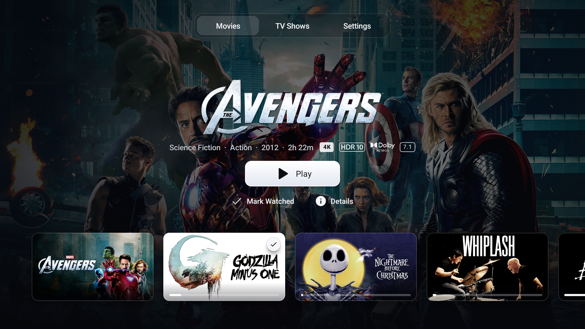
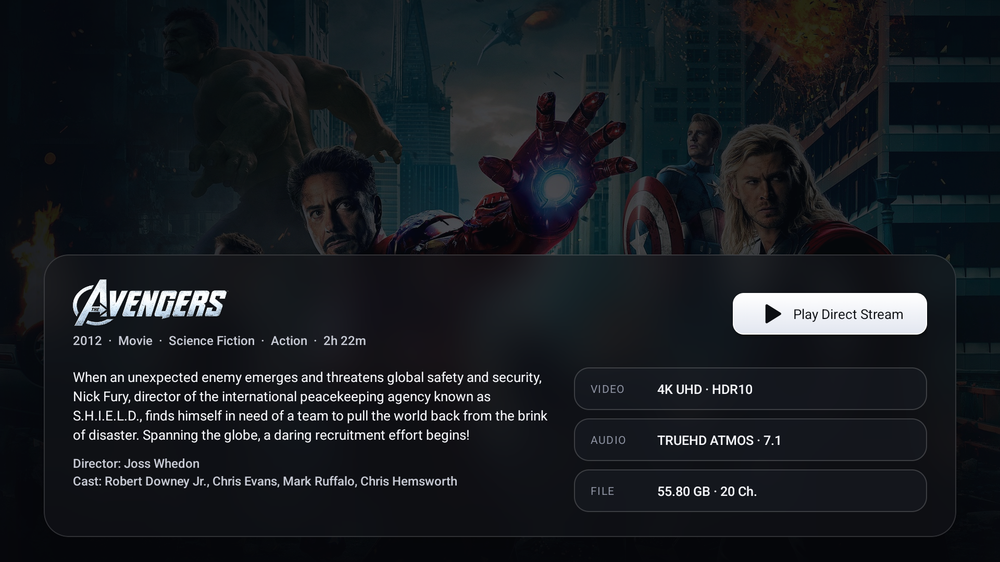
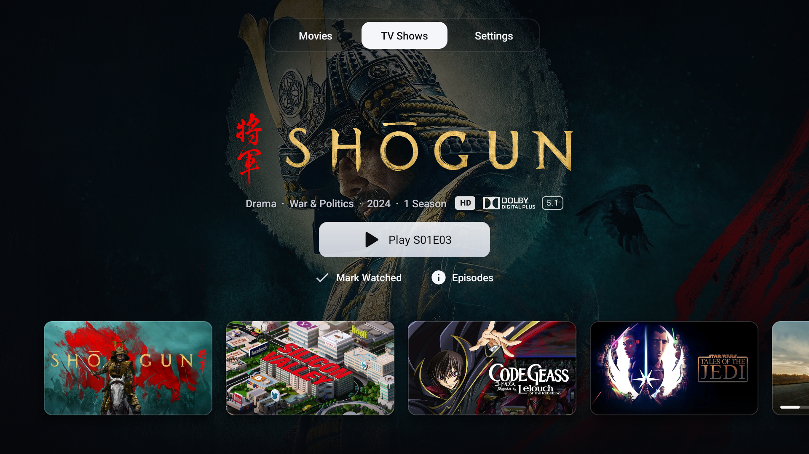
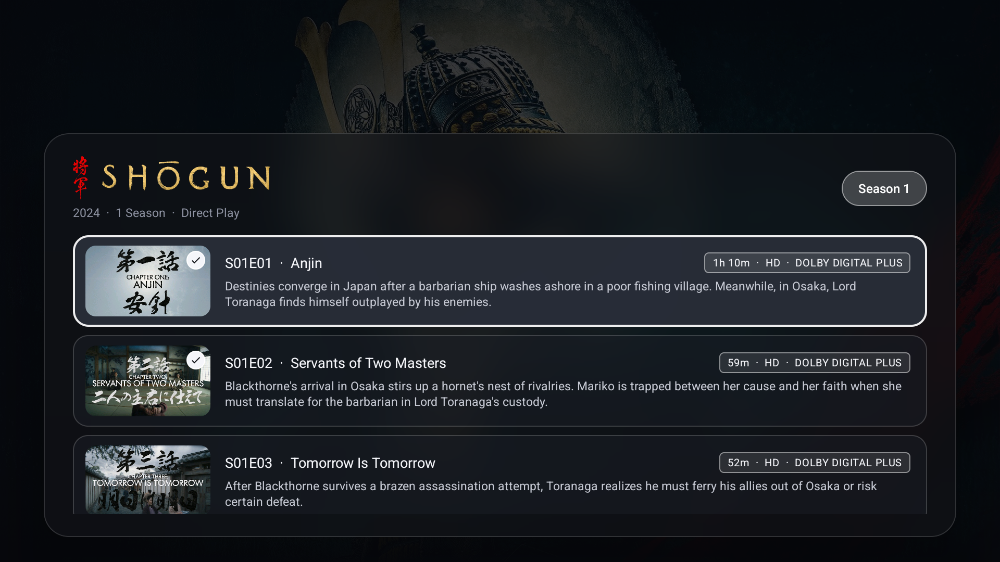
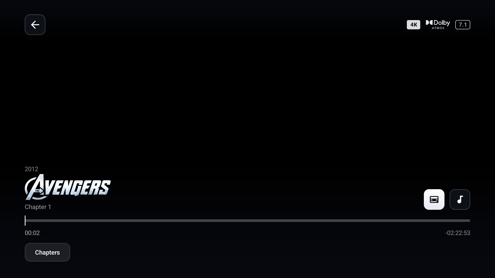
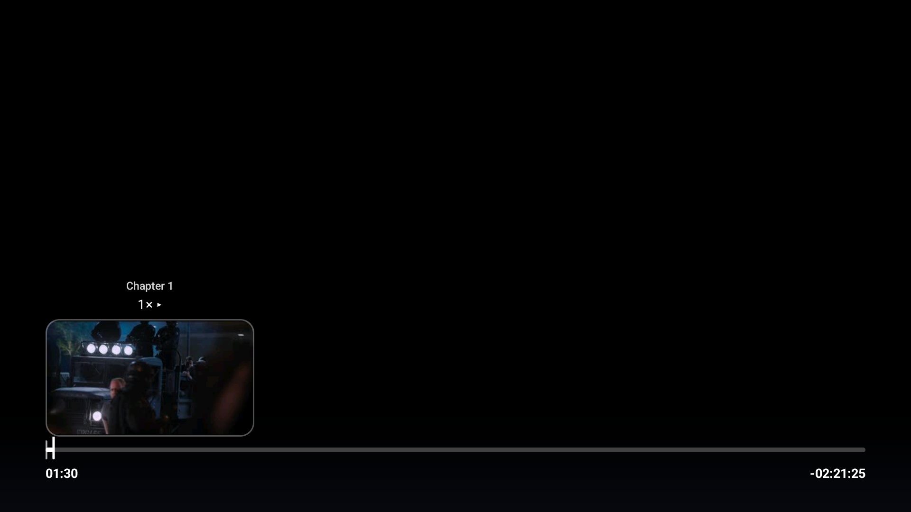
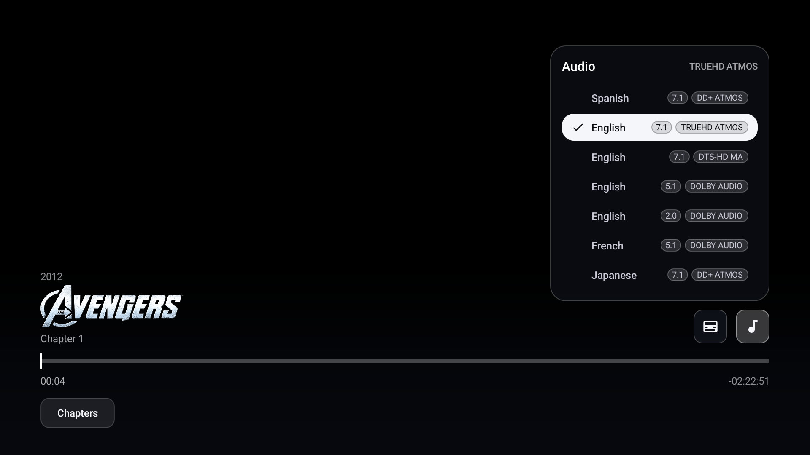
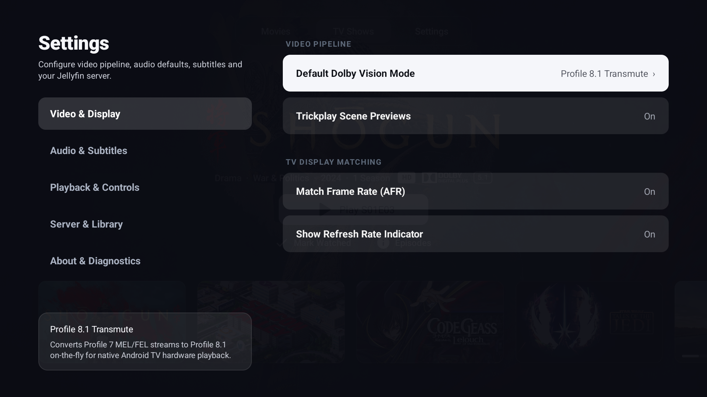
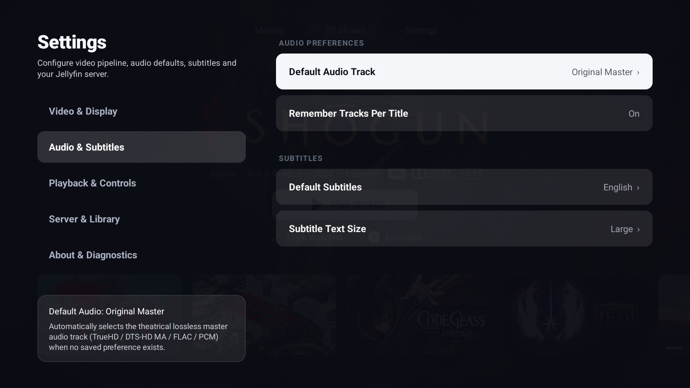

# 4K UHD Remux Player for Android TV

A native, high-performance **Android TV** media player inspired by **Apple TV+ (tvOS 18)**, engineered for zero-transcoding **Direct Play** of 4K Blu-ray Remuxes (`MKV` / `HEVC` / `Dolby Vision` / `TrueHD Atmos` / `DTS-HD MA`) from a self-hosted **Jellyfin** server.



---

## Highlights

- **Apple TV+ (tvOS 18) Cinema UI** — Centered ClearLogo hero, symmetrical top segmented dock (`Movies · TV Shows · Settings`), official monochrome format marks (`4K`, `HDR10`, `Dolby Vision`, `Dolby Atmos`, `DTS-HD MA`, `7.1`), panoramic bottom drawers for Details & Episodes, and a full **tvOS Split View Settings** screen.
- **Dolby Vision Profile 7 → Profile 8.1 Transmutation (Zero-Copy)** — Rust (`libdovi-ffi`) + C++20 NDK pipeline (`native-pipeline`) that drops NAL Unit 63 (`FEL`) and transmutes NAL Unit 62 (`RPU`) on-the-fly to `dvhe.08` for hardware MediaCodec playback on consumer Android TV SoCs.
- **Lossless 7.1 Audio Pipeline** — Media3 / ExoPlayer with Jellyfin's **FFmpeg audio decoder extension** (`audio/true-hd`, `DTS-HD MA`, `FLAC`, `LPCM`) and explicit differentiation between **TrueHD Atmos (Lossless)** and **DD+ Atmos (E-AC3)** in audio track selection, details, and quality ranking.
- **Apple TV Scrubbing & Trickplay** — Smooth `1×` to `5×` forward/rewind scrubbing with step-down directional control (`5× → 4× → 3× → 2× → 1×`), origin-position tick marker, and live Jellyfin Trickplay scene preview cards.
- **True Live Transparent Player Menus** — SurfaceFlinger-composited semi-transparent popups for Audio, Subtitles, Chapters, and Dolby Vision mode that keep 4K video playing live underneath.
- **Smart Track Memory & Auto Frame Rate (AFR)** — Automatically selects the original theatrical lossless audio track by default, remembers per-movie and per-series audio/subtitle choices (including `Off`), and matches TV display refresh rates (`23.976 / 24 / 25 / 50 / 60 Hz`).

---

## UI Showcase

### Catalog & Panoramic Drawers

| Home — Movies | Panoramic Details Drawer |
| :---: | :---: |
|  |  |

| Home — TV Shows | Panoramic Episodes Drawer |
| :---: | :---: |
|  |  |

### 4K Direct Play Player & Live Menus

| Minimalist Player HUD | Apple TV `1×–5×` Trickplay Scrubbing |
| :---: | :---: |
|  |  |

| Live Audio Track Selector (`TrueHD Atmos` vs `DD+ Atmos`) |
| :---: |
|  |

### tvOS Split View Settings

| Video & Display | Audio & Subtitles |
| :---: | :---: |
|  |  |

---

## Architecture

```text
remux-player-android-tv/
├── app/                # Android TV UI (Kotlin, ViewBinding, tvOS Split View Settings, Player HUD)
├── core-media/         # Jellyfin Direct Play REST client, Metadata Mapper, ExoPlayer factory, Audio EDID & AFR
├── native-pipeline/    # C++20 Android NDK: HEVC NALU parser, MediaCodec sink, native subtitle pipeline
├── libdovi-ffi/        # Rust C-ABI crate wrapping libdovi for on-the-fly Dolby Vision RPU transmutation
└── docs/screenshots/   # 1080p emulator captures
```

### Tech Stack

- **Android TV / UI:** Kotlin, AndroidX, Media3 ExoPlayer, ViewBinding, Coroutines
- **Media & Decoding:** `media3-ffmpeg-decoder` (7.1 TrueHD / DTS-HD / FLAC), Jellyfin Trickplay Engine, Android Display Mode AFR
- **Native / Systems:** C++20 (Android NDK + CMake), Rust (`libdovi-ffi` static library via `cargo-ndk`)
- **Networking & Security:** Ktor HTTP Client, `kotlinx.serialization`, URL & token validation (`TokenVault`, `NetworkUrlSecurity`)

---

## Build & Test

### Prerequisites
- JDK 17+ and Android SDK (API 34+)
- Android NDK r26+ and CMake 3.22.1+
- *(Optional, only if rebuilding the Rust crate)* Rust toolchain + `cargo-ndk` (`rustup target add aarch64-linux-android`)

### Run Unit Tests & Build Debug APK
```bash
./gradlew :core-media:testDebugUnitTest :app:assembleDebug
```

### Build Release APK
```bash
./gradlew :app:assembleRelease
```

The generated APK is located at `app/build/outputs/apk/debug/app-debug.apk` (or `release/app-release.apk`).
