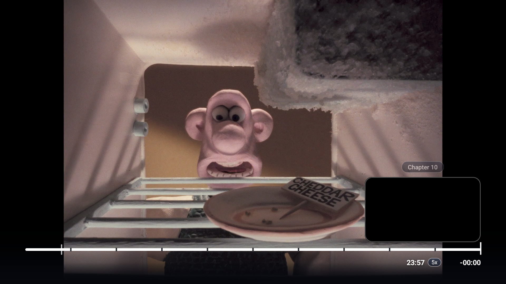
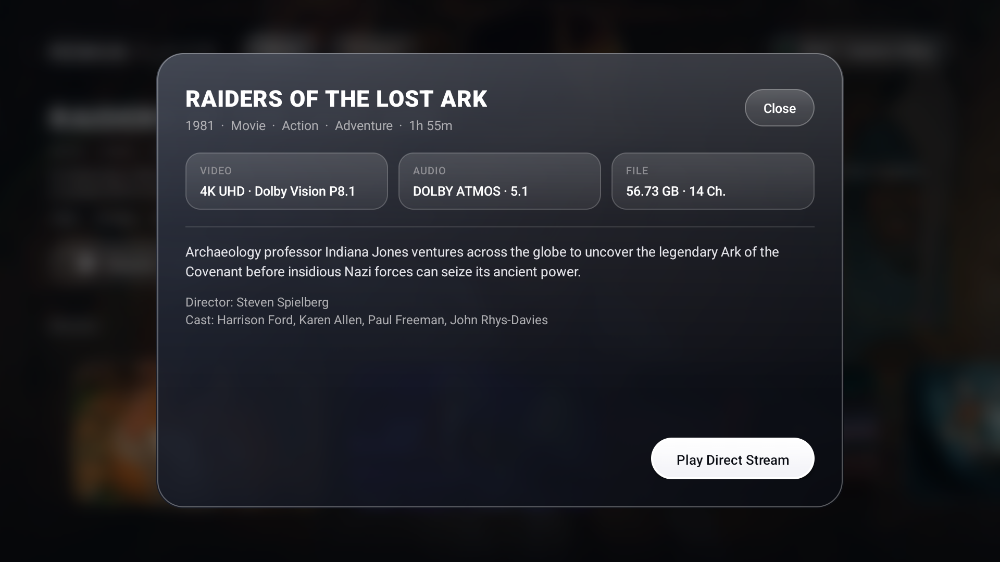
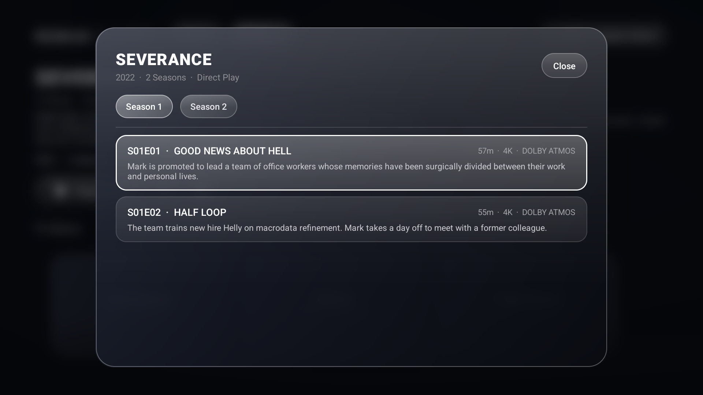
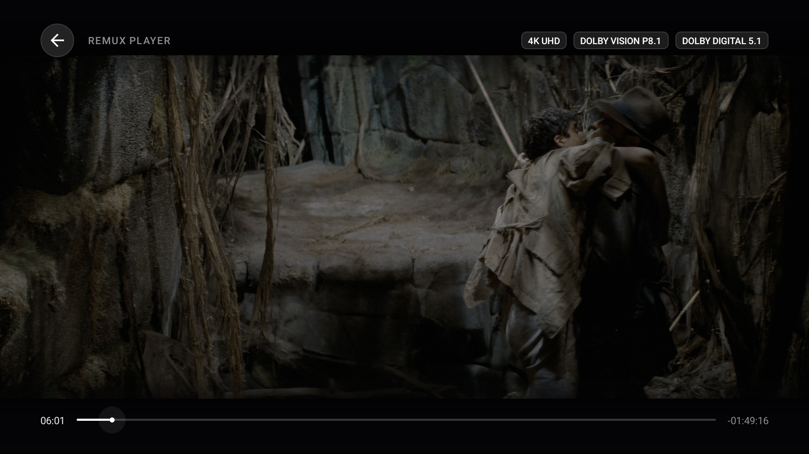

# REMUX Player para Android TV

Cliente y reproductor multimedia nativo para Android TV diseñado para reproducir archivos **4K UHD Blu-ray Remux** (+80 GB, tasas de bits de ~100 Mbps) directamente desde un servidor Jellyfin local, sin transcodificación en el servidor ni pérdidas de calidad.

La interfaz está inspirada en tvOS / Apple TV, enfocada en la navegación fluida con control remoto (D-pad) a 60 fps y una estética visual limpia con efecto cristal líquido (*Liquid Glass*).

---

## Capturas de Pantalla

### 1. Pantalla Principal y Catálogo
Navegación fluida por carrusel de películas y series con *ClearLogo* oficial en alta definición, sinopsis, metadatos técnicos en tiempo real (resolución, HDR/Dolby Vision, códec de audio y canales) y estantería inferior.

---

### 2. Adelantado y Rebobinado Rápido (*Scrubbing* estilo Apple TV)
Al avanzar o retroceder, el video de fondo se pausa en el último fotograma emitido sin dar saltos bruscos. La línea de tiempo despliega una tarjeta flotante con aguja e indicador de capítulos que muestra miniaturas fluidas a 60 fps respaldadas por hojas de mosaicos (*Trickplay sprite sheets*) precargadas en memoria RAM.

---

### 3. Ficha Técnica y Especificaciones del Archivo
Panel flotante con efecto de desenfoque dinámico que detalla el contenedor, perfil exacto de Dolby Vision, pistas de audio HD, tamaño real en disco y lista de capítulos interactiva.

---

### 4. Selector de Series y Episodios
Explorador jerárquico de temporadas y episodios con sincronización de estado de reproducción y marcado de episodios vistos.

---

### 5. Renderizado de Subtítulos PGS y Reproducción Lossless
Decodificación directa por hardware con subtítulos de alta definición renderizados sin deformar la relación de aspecto del video.

---

## ¿Por qué nació este proyecto?

La mayoría de los reproductores disponibles en Android TV (incluyendo clientes oficiales de Jellyfin, Plex o Kodi con configuraciones por defecto) presentan problemas habituales al enfrentarse a archivos Blu-ray Remux pesados:

1. **Forzado de transcodificación:** El servidor detecta perfiles complejos de Dolby Vision (como el Perfil 7 con capas FEL/MEL) o pistas de audio TrueHD/DTS-HD y decide transcodificar a 1080p SDR, quemando la CPU del servidor y destruyendo la calidad original.
2. **Tirones por tasa de refresco (*Judder*):** Las películas grabadas a 23.976 fps reproducidas en pantallas a 60 Hz sufren de artefactos de movimiento causados por la conversión 3:2 pulldown si el reproductor no cambia la frecuencia del panel.
3. **Cuellos de botella en el hardware del televisor:** Los procesadores de televisores Smart TV suelen tener entre 1.5 GB y 2 GB de memoria RAM. Intentar extraer fotogramas para miniaturas en tiempo real con `MediaMetadataRetriever` bloquea el hilo principal y congela la aplicación.

REMUX Player se diseñó específicamente para sortear estas limitaciones atacando cada punto desde el nivel de arquitectura.

---

## Decisiones Técnicas y Arquitectura

* **Hardware Tunneled Video (ExoPlayer / Media3):** El flujo de video se inyecta directamente desde el decodificador de hardware al procesador de pantalla del televisor sin copias intermedias en memoria de usuario.
* **Auto Frame Rate (AFR):** Integración nativa con la API de `Display.Mode` de Android para cambiar la salida del HDMI a la frecuencia exacta del contenido (23.976 Hz, 24.000 Hz, 59.94 Hz, etc.) antes de iniciar la reproducción, eliminando el judder.
* **Paso Directo de Audio HD (Bitstream Passthrough):** Consulta dinámica de las capacidades EDID del puerto HDMI para enviar Dolby TrueHD, Dolby Atmos, DTS-HD Master Audio y DTS:X sin alterar al receptor AV o barra de sonido.
* **Transmutación Dolby Vision (Rust + C++):** Parseo de unidades NALU de HEVC para descartar la capa de mejora Full Enhancement Layer (evitando saturar el bus del SoC) y transmutación al vuelo de metadatos RPU a Perfil 8.1 mediante `libdovi` vinculada estáticamente vía FFI.
* **Motor de Trickplay con Caché LRU de Dos Niveles:**
  * En lugar de pedir fotogramas individuales por HTTP, se descargan hojas de mosaico de 10x10 (100 capturas por archivo, 320x180 px en formato `RGB_565`).
  * Una caché en memoria de 16 hojas mantiene más de 4 horas continuas de timeline listas para recorte sincrónico en 0 ms.
  * Hojas adyacentes se precargan en segundo plano de manera predictiva según la dirección del desplazamiento.
* **Seguridad de Credenciales:** Los tokens de sesión y acceso a la red local se almacenan cifrados mediante AES-GCM vinculados al Android Keystore del dispositivo.

---

## Estado del Proyecto y Código Fuente

> **Nota:** El código fuente de esta aplicación se mantiene actualmente como **propiedad privada** mientras continúa su fase de desarrollo activo y uso personal. 
> 
> Si eres reclutador, evaluador técnico o estás interesado en conocer detalles de implementación, arquitectura o agendar una revisión de código, puedes contactarme directamente a través de mi perfil de GitHub o por correo electrónico.

---

*Desarrollado por [Julio Guerrero](https://github.com/jcguerrerod).*
